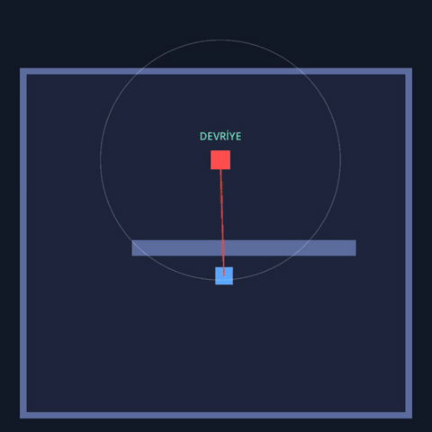
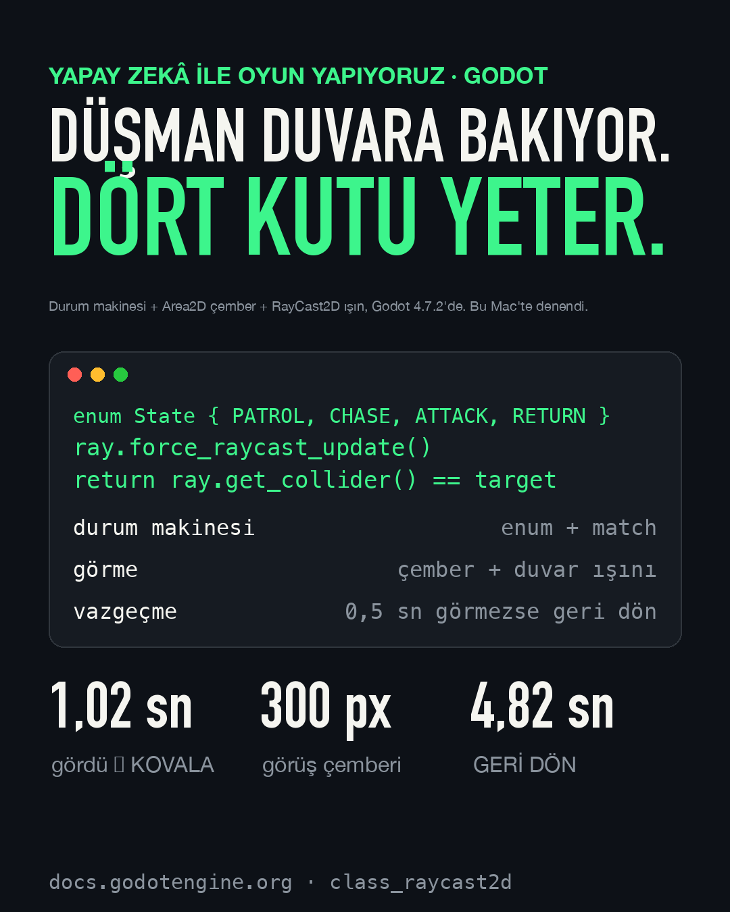

# Godot 4 düşman yapay zekâsı: durum makinesi + görüş

`PATROL → CHASE → ATTACK → RETURN` durum makinesi. Görüş = Area2D çemberi (300 px) **ve** duvarı kontrol eden RayCast2D: duvar arkasındaki oyuncuyu görmez.



[▶ Adım adım anlatımlı video: video.mp4](video.mp4)



[▶ Tam kalite video: demo.mp4](demo.mp4)

`demo.mp4`: Godot Movie Maker kaydı.

## Çalıştır

`godot` = Godot 4.x çalıştırılabilir dosyası (yalnız GDScript, C# yok).

```bash
godot --path godot                      # elle oyna: ok tuşları
godot --headless --path godot --fixed-fps 60 --quit-after 480 -- --auto
```
Bizdeki sonuç: 0,00 devriye (oyuncu duvar arkasında, ışın kırmızı) · 1,02 sn kovala · 2,27 sn saldır · görüş 0,5 sn kesilince geri dön.
